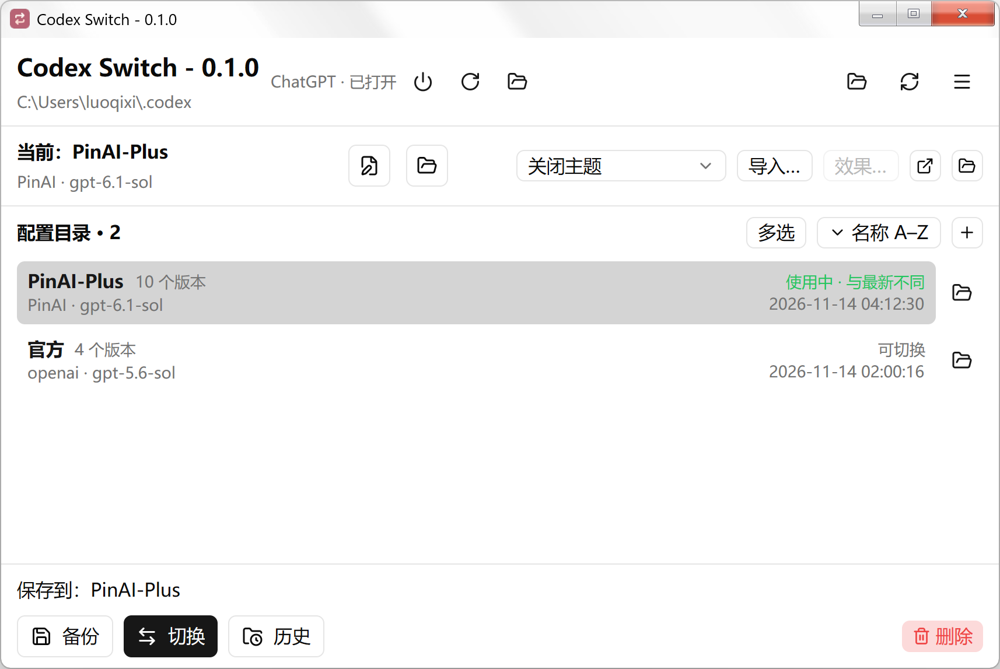

# Codex Switch

一个基于 Rust 和 GPUI Kit 的本地 Codex 配置管理工具，支持 Windows 和 macOS，方便在不同账号、供应商和模型配置之间切换。

## 功能

- **配置管理**：查看配置列表、当前使用状态、供应商和模型，支持按名称或备份时间排序。
- **备份与切换**：按名称管理 `config.toml` 和 `auth.json`，切换前自动备份当前文件；切换配置及备份到其他配置目录前需确认。
- **历史版本**：查看、还原或删除指定版本，默认保留最新 10 个版本，数量可在设置中调整。
- **配置编辑**：内置 TOML 编辑器，支持语法高亮、查找和格式校验，也可使用外部程序打开文件。
- **便捷操作**：支持右键菜单、双击切换、多选批量删除，以及快速打开配置和备份目录。
- **ChatGPT 管理**：查看运行状态，打开、关闭或重启应用，并可定位安装位置。
- **托盘与设置**：支持从托盘快速切换配置（切换前需确认）、托盘常驻、开机启动、自定义 ChatGPT 路径和窗口关闭行为。
- **DreamSkin 主题**：在主界面切换、关闭主题，批量导入 ZIP 或背景图片、打开主题目录，并调整当前主题的背景透明度。

## 主题

主题功能基于 [Codex Dream Skin](https://github.com/Fei-Away/Codex-Dream-Skin) 的渲染器集成，保留其 MIT 许可及来源说明。可从 [DreamSkin 主题库](https://dreamskin.cc/gallery) 下载主题，也可通过主界面的主题库按钮打开。

主题默认关闭。在设置中可指定主题目录，留空使用程序旁的 `Themes`。导入 ZIP 时按根目录（或第一个非点号开头文件夹）的 `manifest.json` 中的 `themeId` 建立主题文件夹，不做版本或哈希校验。手动解压的主题也会自动识别；在下拉框中选择主题后，可通过“效果…”调整背景透明度。
