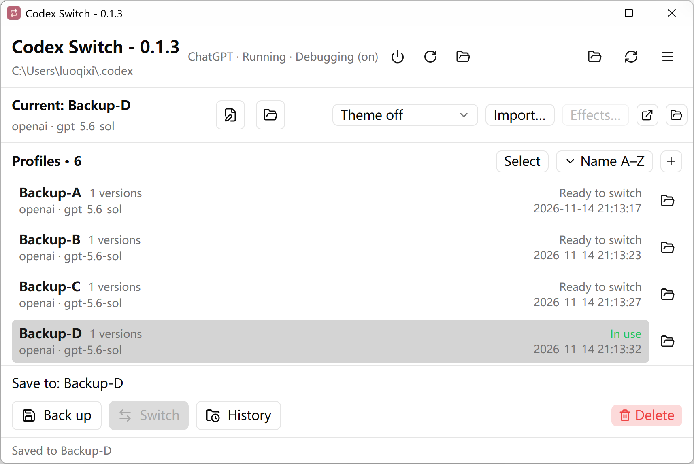

# Codex Switch

A local Codex configuration manager built with Rust and GPUI Kit for Windows and macOS. Switch between accounts, providers, and model configurations, manage backups, and customize themes.



## Download

Get the latest version from [GitHub Releases](https://github.com/luoluoqixi/codex-switch/releases/latest), or use the direct download links:

| Platform | Download |
| --- | --- |
| Windows | [MSI installer](https://github.com/luoluoqixi/codex-switch/releases/latest/download/codex-switch-windows.msi) |
| macOS | [DMG installer](https://github.com/luoluoqixi/codex-switch/releases/latest/download/codex-switch-macos.dmg) |

## Build on Windows

```sh
cargo bundle --release --format wxsmsi
```

## Build on macOS

`cargo build --release` produces a Unix executable. Use `cargo bundle --release` to create the `.app` bundle:

```sh
cargo install cargo-bundle --version 0.12.0 --locked
cargo bundle --release
open "target/release/bundle/osx/Codex Switch.app"
```

## Features

- **Languages:** English and Simplified Chinese. On first launch, Chinese system locales use Simplified Chinese; all other locales use English. Choose a language in Settings and save to apply it immediately. The choice is remembered for future launches.
- **Profile management:** View profiles, their current status, providers, and models. Sort by name or backup time.
- **Backups and switching:** Manage named backups of `config.toml` and `auth.json`. Current files are backed up automatically before switching. Switching profiles and backing up to a different profile require confirmation.
- **Version history:** View, restore, or delete individual backup versions. The latest 10 versions are kept by default; adjust the limit in Settings.
- **Configuration editor:** Edit TOML with syntax highlighting, search, and validation, or open it in an external application.
- **Quick actions:** Context menus, double-click switching, batch deletion, and shortcuts to configuration and backup folders.
- **ChatGPT controls:** View app status, open, close, or restart the app, and reveal its installation location.
- **Tray and settings:** Quickly switch profiles from the tray with confirmation. Keep the tool in the tray, enable launch at login, and configure the ChatGPT path and window closing behavior.
- **DreamSkin themes:** Switch or disable themes, import multiple ZIPs or background images, open the theme folder, and adjust background transparency.

## Themes

Theme support integrates the renderer from [Codex Dream Skin](https://github.com/Fei-Away/Codex-Dream-Skin). Download themes from the [DreamSkin gallery](https://dreamskin.cc/gallery), also accessible from the theme gallery button in the main window.

Themes are off by default. Set a theme directory in Settings, or leave it blank to use `Themes` beside the executable on Windows. The macOS app bundle uses `~/Library/Application Support/Codex Switch/Themes` by default.

ZIP import creates a folder using `themeId` from `manifest.json`, found at the archive root or in its first folder whose name does not start with a dot. It skips version and hash checks. Themes extracted manually into the theme directory are also recognized. Select a theme from the dropdown, then use **Effects…** to adjust background transparency.
